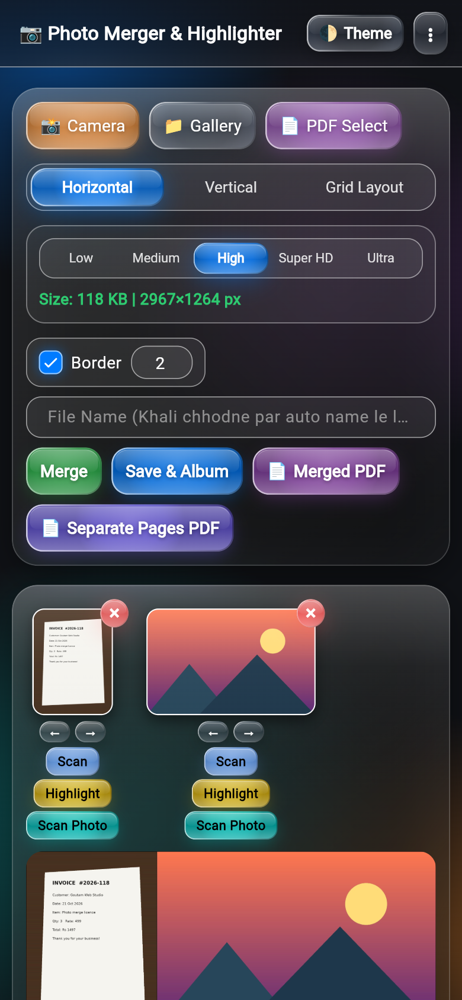
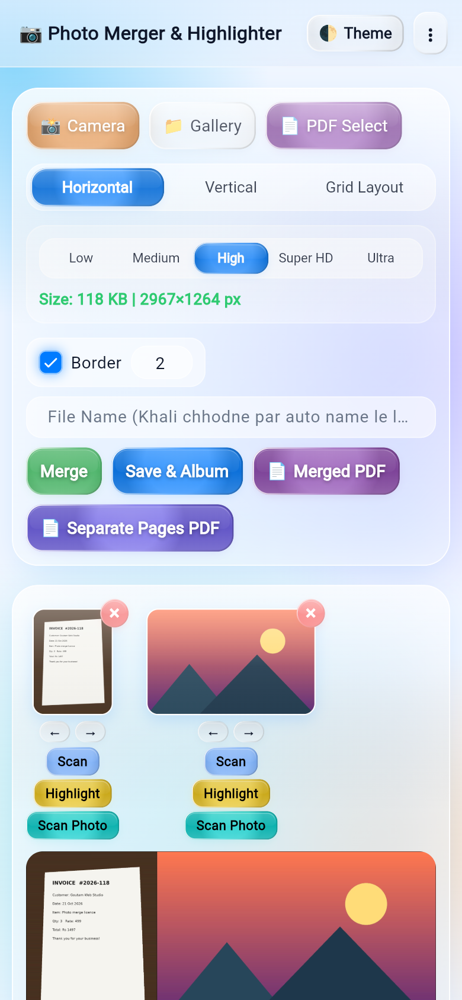
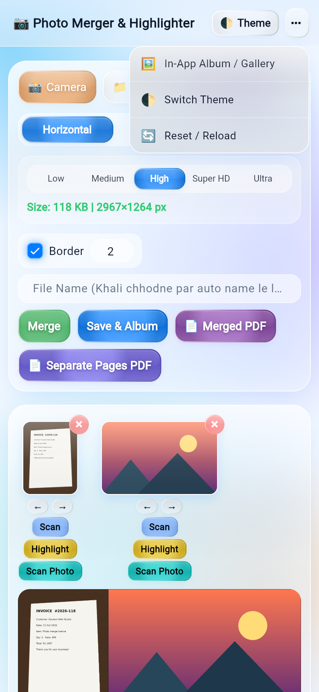
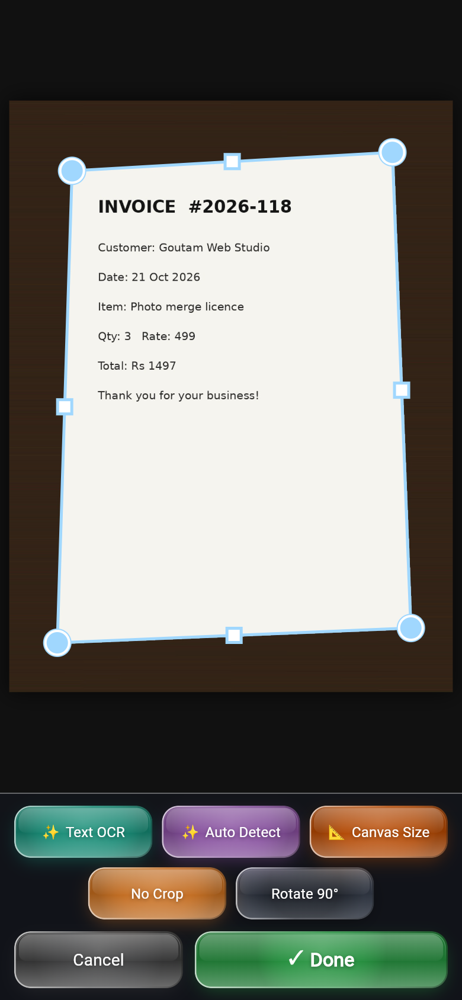
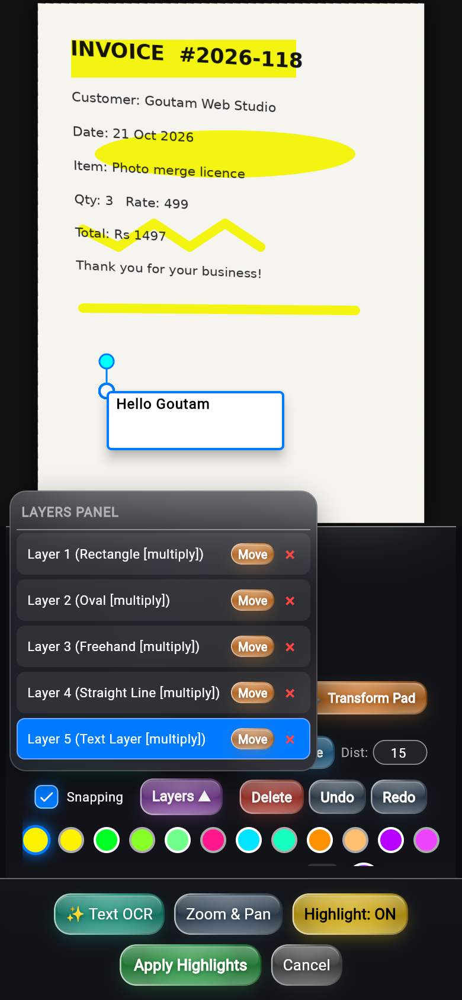
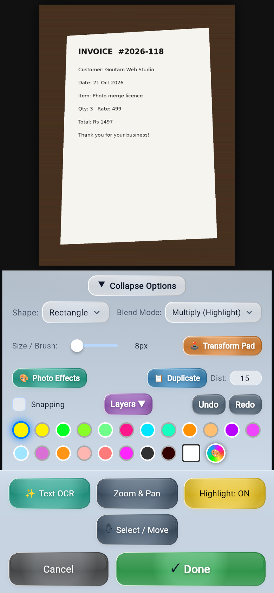
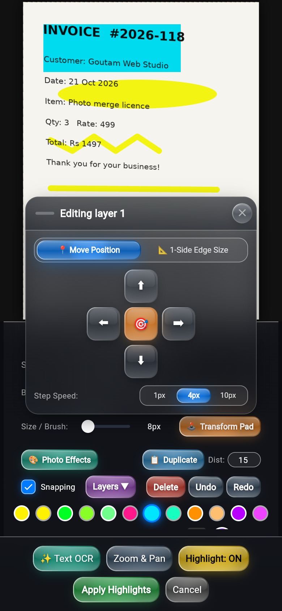
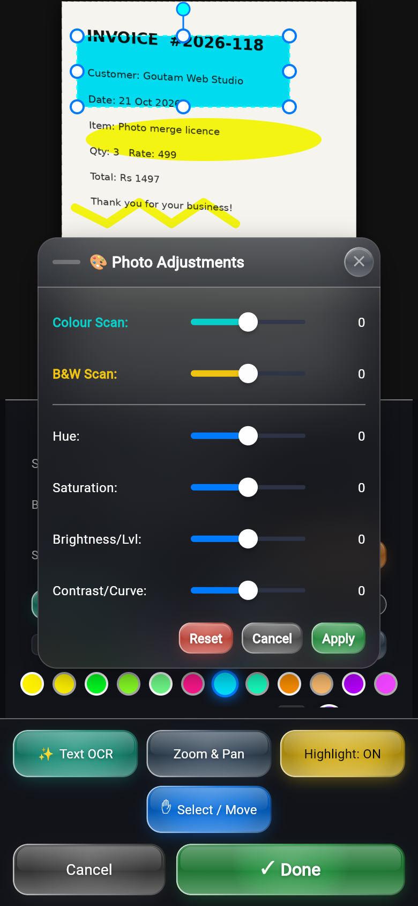
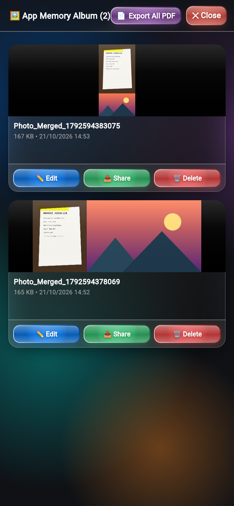
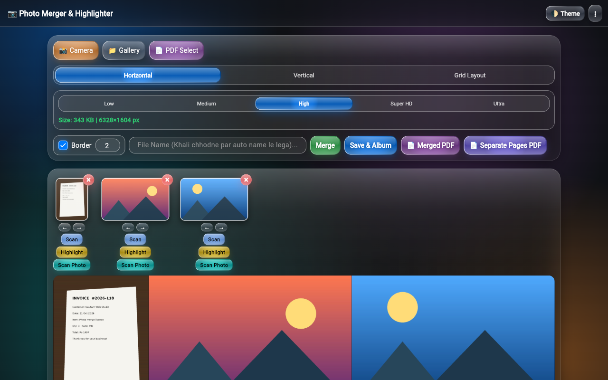

# Photo Highlighter (Flutter)

A Flutter rewrite of the single-file HTML app **"Photo Merger & Highlighter"**,
with an iOS-style **liquid glass** UI and smooth animations throughout.
It runs on Android, iOS and the web.

## What it does

- **Add photos** from the Camera, the Gallery (several at once) or a **PDF**. For a PDF, you pick the pages to load, for example `1, 5, 9` or `1-5`.
- **Merge** the photos **horizontally**, **vertically** or in a **grid**. There are 77 grid layouts, plus *Auto Adjust*.
- **Quality presets:** Low, Medium, High, Super HD and Ultra. A live label shows the file size and pixel dimensions.
- **Border** on/off with a custom width, and a **file name** field.
- **Save & Album** saves the JPEG and stores it in the in-app album. Other exports:
  - **Merged PDF**: everything on one page.
  - **Separate Pages PDF**: one page per photo.
- **Per-photo actions:**
  - Reorder (← →, with a FLIP slide animation).
  - Remove (×, with an exit animation).
  - **Scan Photo**: a photocopy filter that cycles through 3 passes and restores the original on the 4th tap.
- **Scan editor:**
  - Automatic document **edge detection**.
  - **Perspective crop** with 8 handles and a magnifier.
  - Rotate 90°, No Crop, and Canvas Size (px / mm / cm, white fill).
- **Highlight editor:**
  - Shapes: rectangle, oval, freehand, straight line, text.
  - **Select & Transform**: resize, rotate, snapping guides, duplicate, delete.
  - Undo and redo; a layers panel; Multiply or Normal blend.
  - Colour palette and colour picker (grid and spectrum, hex and RGB).
  - **Transform Pad**: move, or resize one edge at a time.
  - **Photo Effects**: hue, saturation, brightness, contrast, colour scan, B&W scan.
  - Zoom & Pan.
  - **Text OCR** (Tesseract, English + Hindi; web only).
- **Album:**
  - Grid of saved images, a zoomable viewer, and Export All PDF.
  - **Edit** restores the full editable project, highlights included.
  - Share and Delete.
- **Themes:** dark and "Light Blue". The theme cross-fades when you switch, and it persists between sessions.

## Liquid glass UI

The glass widgets live in `lib/widgets/liquid_glass.dart` and `lib/widgets/glass.dart`.

- **Surfaces**
  - Translucent, tinted "water" fill with a convex radial bulge.
  - Backdrop blur. All button blurs share one snapshot through `BackdropGroup` and `BackdropFilter.grouped`.
  - A soft specular sheen on the upper half.
  - A refraction rim: bright at the top-left, dark at the bottom-right.
  - An inner glow at the bottom.
  - Theme-aware shadows: a coloured glow in dark mode, a small soft shadow in light mode.
- **Press feedback**
  - A real spring simulation squishes the button to about 0.94, then bounces it back.
  - On release, a shimmer sweeps across the button.
- **Coverage:** the same style is used on every button, the segmented controls (sliding glass indicator), chips, selects, the thumbnail actions and the × badges.
- **Motion**
  - Glass page transitions and slide-up editor routes.
  - Spring-in dialogs and toasts.
  - Staggered entrance animations.
  - An animated liquid blob background.
  - An `AnimatedSwitcher` on tool and option changes.

## Run / build

```bash
flutter pub get
flutter run -d chrome          # web
flutter run                    # device / emulator
flutter test                   # unit + widget tests
flutter build web --release
flutter build apk --release    # build/app/outputs/flutter-apk/app-release.apk
```

## Project structure

```
lib/
  main.dart                 app entry, animated theme scope, BackdropGroup
  theme/app_theme.dart      palettes (CSS vars), lerp for the theme cross-fade
  widgets/                  liquid glass, toast, dialogs, movable windows, thumbnails, FLIP slot
  screens/                  home, album/gallery, image viewer, editor/ (scan + highlight)
  models/                   shapes, photo items, constants (grid layouts, presets, palette)
  services/                 image ops (merge, warp, filters), edge detector, PDF, album (Hive), platform (web/io)
  state/app_state.dart      app state (ChangeNotifier)
test/                       logic + widget tests
```

## Screenshots

| Home (dark) | Home (light) | Menu (light) |
|---|---|---|
|  |  |  |

| Scan / crop | Highlight + layers | Highlight (light) |
|---|---|---|
|  |  |  |

| Transform Pad | Photo Effects | Album |
|---|---|---|
|  |  |  |

Desktop:



More screenshots are in [`screenshots/`](screenshots/).

## Notes

- **OCR** uses tesseract.js on the web and on-device Google ML Kit (Latin + Devanagari/Hindi) on Android. Result sheet: Copy / Share / Add as text layer.
- **Edge detection** is a pure-Dart, Canny-style pipeline. It approximates the original's OpenCV.js `findContours` / `approxPolyDP` rather than matching it exactly.
- **Very large merges** fall back to the GPU's 8192 px texture limit. An HTML canvas allows larger.
- **Saving on mobile** writes the file and then opens the share sheet.


## Changelog

### v1.0.2
- **Move any layer.** Tap a layer (rectangle, oval, thin line, freehand, text) to select it and drag it with one finger; precise hit-testing picks the top-most layer (24 px finger slop). Handles for resize/rotate stay. A liquid-glass **Select / Move** tool makes empty taps only deselect (never draw). Each layer keeps its own position, blend mode and colour; moves are undo/redo-able and the layer list stays in sync.
- **Smooth dragging.** Drag starts on pointer-down (raw `Listener`), is exactly 1:1 with the finger (snapping off by default), Zoom & Pan is locked during a layer drag, only the canvas repaints (no whole-screen `setState`), the non-moving layers are cached as one `Picture`, and history is committed on pointer-up only.
- **Scan editor.** Single liquid-glass **Done** button applies every pending change (crop frame, rotation, canvas size, OCR text) and returns home; **Cancel** discards everything (including rotation / canvas size, which previously leaked). The crop warp now runs on the CPU (isolate) on Android with GPU fallback, errors are shown instead of silently leaving the old photo, and the home thumbnail / highlight-editor input refresh from the new bytes.
- **On-device OCR on Android** (ML Kit, Latin + Devanagari) with a glass result sheet; tesseract.js stays on web. minSdk is now 24.
- Fixes: crash dragging crop handles when auto-detect found no quad, magnifier hidden under the bottom bar, button rows overflowing on narrow phones.
- Tests: widget/logic tests (`test/layer_test.dart`, `test/editor_test.dart`) and Playwright web flows in `e2e/`.

### v1.0.1
- **Fix: black screen / stuck on splash on real devices.** The v1.0.0 release build was minified by R8, which renamed plugin methods that `package:jni` (used by `shared_preferences`/`path_provider`) looks up by name -> `NoSuchMethodError` during start-up, and `main()` awaited that call before `runApp`. R8 is now off and keep rules were added.
- `main()` is now crash-proof: `runApp` runs immediately, storage loads asynchronously with timeouts and an in-memory fallback, and any error shows an on-screen error view instead of a black screen.
- New app icon (adaptive icon, native splash with the same icon, web icons, SVG master in `assets/icon/icon.svg`).
- Release APKs are signed with the owner's release key (`android/key.properties` is git-ignored). **Uninstall v1.0.0 first** - the signing key changed.
